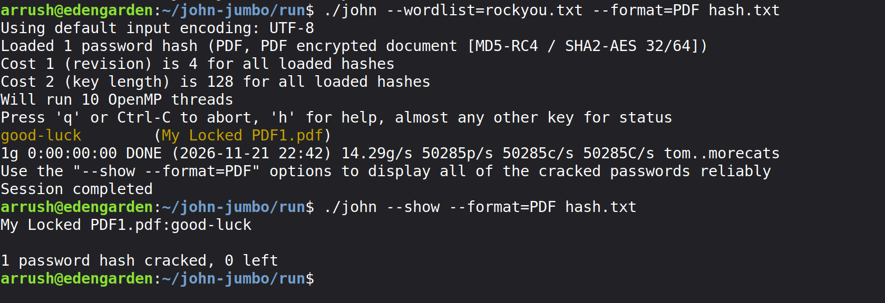
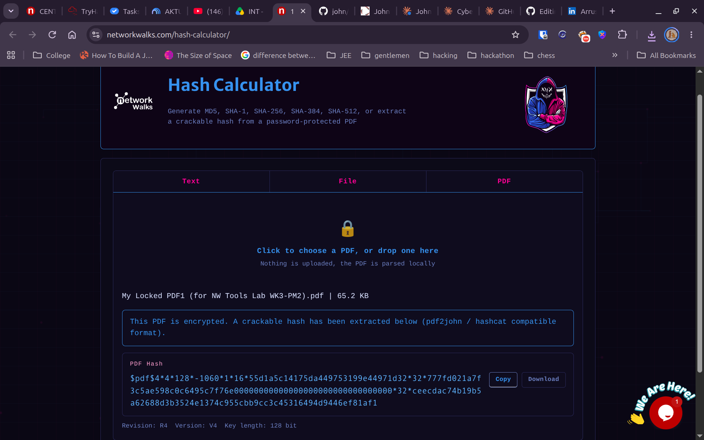

# NETWORKWALKS-B084-WK3-Password-cracking-using-JTR
I used john the ripper and a password cracking tool by networkwalks to crack 2 paassword protectedd pdf that were part of my lab 


# 🔐 Password Cracking & Cryptographic Hash Auditing Report

**Week 3 Practical Labs | Cybersecurity & Ethical Hacking Internship | NETWORKWALKS**

| 👤 Intern / Pentester Details | |
| :--- | :--- |
| **Pentester Name** | Arrush Vir Singh |
| **Program / Batch** | B084-Networkwalks |
| **Date** | 22 November 2026 |
| **Modules Completed** | W3-PM1 (John the Ripper CLI & Johnny GUI)<br>W3-PM2 (Networkwalks Hash Calculator & Password Cracker) |
| **Target Systems** | Authorized Lab Encrypted PDFs (`My Locked PDF1.pdf`, `My Locked PDF1 (for NW Tools Lab WK3-PM2).pdf`) |
| **Permission Secured?** | Yes ✅ |

---

## 1. ⚖️ Liability Disclaimer
I have performed all password auditing, hash extraction, and dictionary attack activities documented in this report strictly within an authorized educational environment using lab-provided files from Networkwalks Academy. All tools, commands, and methodologies presented here are intended solely for defensive security awareness, password-strength validation, and authorized penetration testing. Unauthorized password cracking or access to protected files and systems without explicit permission is illegal and strictly prohibited.

---

## 2. 📖 Introduction & Objectives
This Week 3 assessment examines how password-protected documents store cryptographic password hashes rather than plaintext credentials, and how offline dictionary attacks recover weak or predictable passwords. By combining command-line auditing, graphical session management, and browser-based local hash parsing, this report demonstrates the end-to-end workflow of extracting and cracking document hashes.

### 🎯 Objectives
* Understand the mechanics of cryptographic hashing and offline dictionary attacks.
* Extract crackable `$pdf$` hashes from encrypted PDF files using `pdf2john` and client-side hash parsers.
* Execute multi-threaded dictionary attacks using **John the Ripper (CLI)** with the `rockyou.txt` wordlist.
* Analyze and manage cracking sessions visually using **Johnny (GUI)**.
* Perform local browser-based hash extraction and dictionary cracking using **Networkwalks Hash Calculator** and **Networkwalks Password Cracker**.
* Recover plaintext passwords, unlock the target PDF files to capture lab flags, and provide defensive security recommendations.

---

## 3. 🧰 Tools Used

| Tool / Component | Interface / Type | Purpose & Role in Assessment |
| :--- | :--- | :--- |
| **Linux Mint** | Host OS | Local workstation (`edengarden`) used to build and execute the John the Ripper Jumbo suite. |
| **pdf2john** | CLI Utility (John Jumbo) | Extracts password hashes in `$pdf$` format from encrypted PDF documents for offline auditing. |
| **John the Ripper (`john`)** | CLI Password Cracker | High-speed multi-threaded password auditing engine used to run wordlist attacks (`rockyou.txt`) against extracted hashes. |
| **Johnny** | GUI Frontend | Graphical interface for John the Ripper used to load hash files, configure attack modes/wordlists, and monitor cracked passwords visually. |
| **Networkwalks Hash Calculator** | Web Tool (`networkwalks.com/hash-calculator/`) | Client-side parser that reads encrypted PDF metadata locally in the browser and outputs a `pdf2john`/Hashcat-compatible `$pdf$` hash. |
| **Networkwalks Password Cracker** | Web Tool (`networkwalks.com/password-cracker/`) | Browser-based dictionary attack tool that hashes candidate passwords from a wordlist and matches them against a target `$pdf$` hash. |
| **`rockyou.txt`** | Wordlist | Standard password-auditing dictionary containing millions of commonly used passwords. |

---

## 4. 🕵️ Activities Performed & Methodology

### 4.1 Module 1 (`W3-PM1`): Cracking Encrypted PDFs with John the Ripper (CLI) & Johnny (GUI)
In the first lab module, an encrypted PDF (`My Locked PDF1.pdf`) was audited locally using **John the Ripper Jumbo** and its graphical frontend **Johnny**.

1. **Hash Extraction (`pdf2john`):**  
   The encryption metadata of `My Locked PDF1.pdf` was extracted into a crackable `$pdf$` hash string and saved to `hash.txt`. John identified the encryption scheme as **PDF Revision 4, 128-bit key length (`MD5-RC4 / SHA2-AES 32/64`)**.

2. **CLI Dictionary Attack (`John the Ripper`):**  
   From the `~/john-jumbo/run` directory, John the Ripper was executed across 10 OpenMP CPU threads using the `rockyou.txt` wordlist:
   ```bash
   ./john --wordlist=rockyou.txt --format=PDF hash.txt
   ```
   John processed candidates at **50,285 passwords per second (`50285p/s`)** and recovered the plaintext password **`good-luck`**.

3. **Credential Verification (`--show`):**  
   The `--show` option was executed to verify the cracked hash stored in John's potfile:
   ```bash
   ./john --show --format=PDF hash.txt
   # Output: My Locked PDF1.pdf:good-luck
   ```

4. **GUI Workflow Verification (`Johnny`):**  
   To compare CLI execution with graphical session management, `hash.txt` and the wordlist were loaded into **Johnny**. Johnny acts as a visual wrapper around the `john` binary, displaying loaded hashes, session progress, and recovered plaintext credentials in a structured interface without requiring manual terminal flags.

5. **Unlocking the Document & Flag Capture:**  
   Opening `My Locked PDF1.pdf` with the recovered password **`good-luck`** unlocked the document and revealed the flag:
   * **Captured Flag:** `nw{cybersecurity_flag_captured_2608}`

---

### 4.2 Module 2 (`W3-PM2`): Hash Extraction & Dictionary Attack via Networkwalks Web Tools
In the second lab module, a separate encrypted target (`My Locked PDF1 (for NW Tools Lab WK3-PM2).pdf`, `65.2 KB`) was audited using Networkwalks' browser-based tools to examine step-by-step hash extraction and dictionary matching.

1. **Client-Side PDF Hash Extraction (`Networkwalks Hash Calculator`):**  
   The encrypted PDF was loaded into `networkwalks.com/hash-calculator/` under the **PDF** tab. The utility parsed the file locally in the browser without uploading it to an external server, identified **Revision R4, Version V4, 128-bit encryption**, and extracted the following `$pdf$` hash:
   ```text
   $pdf$4*4*128*-1060*1*16*55d1a5c14175da449753199e44971d32*32*777fd021a7f3c5ae598c0c6495c7f76e00000000000000000000000000000000*32*ceecdac74b19b5a62688d3b3524e1374c955cbb9cc3c45316494d9446ef81af1
   ```

2. **Browser Dictionary Attack (`Networkwalks Password Cracker`):**  
   The extracted `$pdf$` hash was pasted into `networkwalks.com/password-cracker/` and tested against the built-in 100-password wordlist (`Active: built-in list, 100 words`). At attempt **91 / 100** (~9 pw/s), the tool matched the hash to the plaintext password **`password1`**.

3. **Unlocking the Document & Flag Capture:**  
   Entering **`password1`** unlocked `My Locked PDF1 (for NW Tools Lab WK3-PM2).pdf`, revealing the flag:
   * **Captured Flag:** `nw{networkwalks_flag1_jtr_270521_1}`

---

## 5. 🔎 Lab Verification & Results Summary

| Lab Module | Target File | Tool / Method Used | Cracked Password | Captured Flag |
| :--- | :--- | :--- | :--- | :--- |
| **W3-PM1** | `My Locked PDF1.pdf` | `pdf2john` + John the Ripper CLI (`rockyou.txt`) & Johnny GUI | `good-luck` | `nw{cybersecurity_flag_captured_2608}` |
| **W3-PM2** | `My Locked PDF1 (for NW Tools Lab WK3-PM2).pdf` | Networkwalks Hash Calculator + Password Cracker (Built-in Wordlist) | `password1` | `nw{networkwalks_flag1_jtr_270521_1}` |

---

## 6. ⚠️ Risk Analysis / Impact

| # | Finding / Observation | Evidence / Component | Potential Impact | Risk Level |
| :--- | :--- | :--- | :--- | :--- |
| 1 | **Use of Common Dictionary Passwords** | Target PDFs protected with `good-luck` and `password1` | Any password present in common wordlists (`rockyou.txt` or top-100 lists) can be recovered within seconds using standard CPU hardware (~50,000+ guesses/sec). | 🔴 **High** |
| 2 | **Offline Hash Extraction Exposure** | `$pdf$` hashes extracted via `pdf2john` and client-side parsers | Once an unauthorized party obtains a copy of an encrypted file, password guessing runs offline with zero account-lockout or rate-limiting protections. | 🟡 **Medium** |
| 3 | **Legacy 128-bit PDF Encryption (Revision 4)** | Both lab PDFs used Revision 4 / 128-bit key length (`MD5-RC4 / SHA2-AES`) | Older PDF encryption revisions allow significantly higher cracking throughput on modern CPUs/GPUs compared to modern AES-256 PDF security handlers. | 🟡 **Medium** |

---

## 7. 💡 Recommendations
1. **Enforce High-Entropy Passwords & Passphrases:**  
   Avoid dictionary words, common phrases (`good-luck`), or predictable patterns (`password1`). Use randomly generated passphrases of at least **14–16+ characters** combining uppercase, lowercase, numbers, and special symbols.
2. **Adopt Modern Encryption Standards (AES-256):**  
   When encrypting sensitive PDFs or archives, use **AES-256 encryption** (PDF 2.0 / Acrobat X and newer standards) to substantially increase the computational cost of offline brute-force and dictionary attacks.
3. **Control File Access & Distribution:**  
   Treat password-protected files as sensitive assets. Store confidential documents in access-controlled repositories rather than sharing them over public or unmonitored channels where attackers can download the file and extract its hash.
4. **Conduct Periodic Password Audits:**  
   Security teams should proactively audit organizational hashes using tools like **John the Ripper** or **Hashcat** in authorized internal assessments to identify and remediate weak credentials before attackers exploit them.

---

## 8. 🎯 Conclusion
During Week 3 of my Cybersecurity & Ethical Hacking internship at **Networkwalks**, I completed practical hands-on labs covering cryptographic hash extraction and offline password auditing. Using **John the Ripper (CLI)**, **Johnny (GUI)**, and the **Networkwalks Hash Calculator & Password Cracker**, I extracted `$pdf$` hashes from encrypted documents, executed dictionary attacks, recovered plaintext passwords (`good-luck` and `password1`), and captured both lab flags.

These exercises demonstrated that encryption is only as resilient as the entropy of the password protecting it. Because offline hash extraction removes online rate-limiting defenses, organizations must pair modern encryption standards (such as AES-256) with strong, high-entropy passphrases and strict access controls.

---

## 9. 📸 Evidences Collected

### 1. John the Ripper CLI — Hash Cracking & Verification (`good-luck`)
*Terminal output showing `./john --wordlist=rockyou.txt --format=PDF hash.txt` cracking the 128-bit PDF hash at 50,285p/s and verifying it with `--show`.*


### 2. Unlocked Target PDF (W3-PM1) — Flag Captured
*Opening `My Locked PDF1.pdf` using the recovered password `good-luck` to reveal `nw{cybersecurity_flag_captured_2608}`.*


### 3. Networkwalks Hash Calculator — Local `$pdf$` Hash Extraction
*Extracting the Revision R4 / Version V4 / 128-bit `$pdf$` hash from `My Locked PDF1 (for NW Tools Lab WK3-PM2).pdf`.*


### 4. Networkwalks Password Cracker — Dictionary Attack Configuration
*Loading the extracted `$pdf$` hash into the browser-based dictionary attack tool with the built-in 100-password wordlist.*


### 5. Networkwalks Password Cracker — Password Match Found (`password1`)
*Dictionary attack completing at attempt 91/100 and identifying the matching password `password1`.*


### 6. Unlocked Target PDF (W3-PM2) — Flag Captured
*Opening `My Locked PDF1 (for NW Tools Lab WK3-PM2).pdf` with `password1` to reveal `nw{networkwalks_flag1_jtr_270521_1}`.*


---

## 👤 Author
**Arrush Vir Singh**  
Cybersecurity Intern (Batch B084) | B.Tech IT Student at AKGEC  
GitHub: [https://github.com/iamarrushvirsingh-ops](https://github.com/iamarrushvirsingh-ops)

## 📌 Project Information
**Program:** Cybersecurity & Ethical Hacking Internship at Networkwalks | **Week:** 03 | **Modules:** W3-PM1 & W3-PM2 | **Repository:** GitHub
